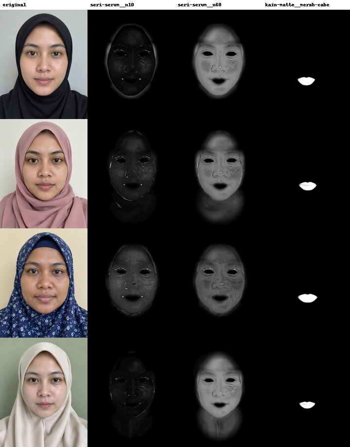

# Hijab framing test against the real YouCam API

Run on 2 November 2026 with four fictional, AI-generated sample shoppers, each in a different hijab. Every number below comes from real API calls. The raw tone results are in `public/cached/manifest.json`, the renders in `public/cached/<model>/`, and the edge measurements in `docs/hijab-edge.json`.

| Sample | Hijab | Hijab colour (sampled) |
|---|---|---|
| Sari | black jersey, tight to the face | `#2b2c30` |
| Aisyah | dusty-rose chiffon pashmina, loose folds at the jaw | `#b8989b` |
| Maria | navy with white floral print, inner cap at the forehead | `#1b2642` |
| Nisa | cream satin, close to skin tone | `#d0cbc5` |

## 1. Skin tone analysis works with a hijab on, but ignore `hair_color`

YouCam's photo guide for the AI Facial Color Tones Analyzer asks for hair down over the chest, and for the face to fill over 60% of the image width. A hijab wearer can't do the first, and our photos don't meet the second. With `face_angle_strictness_level: "medium"`, all four analyses still succeeded on the first try:

| Sample | skin_color | lip_color | hair_color returned | hair_color_name |
|---|---|---|---|---|
| Sari | `#b6947a` | `#b27171` | `#B56637` | Auburn |
| Aisyah | `#ae8c71` | `#a9666c` | `#B56637` | Auburn |
| Maria | `#a2795c` | `#b4777f` | `#FAF0BE` | Blonde |
| Nisa | `#b19074` | `#a86b6b` | `#FAF0BE` | Blonde |

**Finding:** `hair_color` is meaningless when the hair is covered. A black hijab comes back as "Auburn", and the navy hijab as "Blonde", with identical hex values across different photos, which looks like a fallback value. So Cocok Hijab ignores `hair_color` and samples the hijab colour from the photo itself (the crown of the head, where a hijab is always fabric), with an eyedropper for the shopper to correct it.

The skin reading was stable: re-running Aisyah's photo through the live upload path (resized in the browser) returned `#ae8c70` against `#ae8c71`.

## 2. Makeup stays on the face; light hijabs under the chin are the edge case

Foundation is the hard case, because it covers the face right up to the hijab edge. We compared each original photo with a deliberately light shade (`seri-serum__n10`), a deliberately deep one (`seri-serum__n60`) and a bright red lip (`kain-matte__merah-cabe`), measuring mean per-pixel change on hijab pixels against skin pixels:

| Sample (hijab) | Render | Mean change on hijab pixels | Mean change on skin pixels |
|---|---|---|---|
| Sari (black) | light foundation (N10) | 0.54 | 1.4 |
| Sari (black) | deep foundation (N60) | 0.64 | 15.96 |
| Sari (black) | red lip (Merah Cabe) | 0.0 | 2.13 |
| Aisyah (dusty rose) | light foundation (N10) | 0.71 | 3.16 |
| Aisyah (dusty rose) | deep foundation (N60) | 2.99 | 13.5 |
| Aisyah (dusty rose) | red lip (Merah Cabe) | 0.0 | 1.62 |
| Maria (navy floral) | light foundation (N10) | 0.41 | 6.28 |
| Maria (navy floral) | deep foundation (N60) | 0.51 | 10.31 |
| Maria (navy floral) | red lip (Merah Cabe) | 0.0 | 3.34 |
| Nisa (cream) | light foundation (N10) | 0.41 | 1.5 |
| Nisa (cream) | deep foundation (N60) | 2.04 | 15.84 |
| Nisa (cream) | red lip (Merah Cabe) | 0.0 | 1.64 |

Change is in 8-bit levels (0-255), averaged over RGB. The light N10 shade sits close to these skin tones after calibration, so it changes skin only a little; N60 is the stress test.

**Findings:**

- **Lips never touch the fabric:** zero change on hijab pixels for every sample.
- **Dark hijabs are untouched by foundation:** on black and navy fabric the mean change is about 0.5 levels, against 10-16 on skin. This includes the floral print and the inner cap at the forehead.
- **Light hijabs draped under the chin pick up a faint tint from a deep shade:** YouCam's foundation mask extends a little below the jawline. With a dusty-rose or cream hijab folded under the chin, a deep shade (N60) tints that fabric slightly (mean change 2-3 levels, against 13-16 on skin). It shows as a soft halo under the jaw in the difference maps. On the photo it is subtle, but it is a real hijab-specific limitation, and it matters most for shoppers trying shades much deeper than their own skin, which the matcher steers them away from anyway.
- **What we'd do next:** clip the foundation layer with the hijab colour the app already knows: put back original pixels that are close to the hijab colour and below the jaw. The idea needs both images readable in the browser, which works for the cached renders, but YouCam's result URLs would need CORS headers.

## 3. Lip colour render

Lips render cleanly inside the lip line, and skin texture is preserved because we send `skin_smooth` with both strengths at 0. Without that, the engine applies a default smoothing of 50, and shoppers would be judging a beauty filter rather than the shade.

## 4. What this changed in the product

- **Skin analysis also works under a hijab:** the AI Skin Analysis guide asks for a fully visible forehead, but SD analysis of 8 concerns succeeded on all four samples, including the inner-cap hijab. Overall skin scores were 81-84. Low oil-control and hydration scores now pick a matte or dewy base, and low pore, redness, blemish or spot scores pick coverage.
- **Shade calibration:** real `skin_color` values for these selfies sit at L* 54-64 with chroma around 21, darker and less saturated than typical swatch colours. We recalibrated the demo foundation shades into that space, so a match means a match in the photo (best ΔE00 0.8-1.3).
- **Hijab-aware lip rules:** with real tone data, all four shoppers lean warm, so undertone alone gives everyone the same picks. The hijab is what separates them. The top lip picks are Merah Cabe for Sari's black hijab, Mawar Tua for Aisyah's dusty rose, Fuchsia for Maria's navy, and Senja for Nisa's cream.
